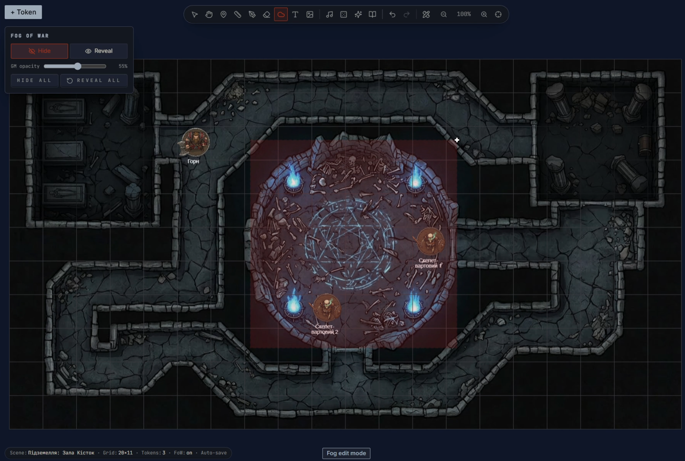
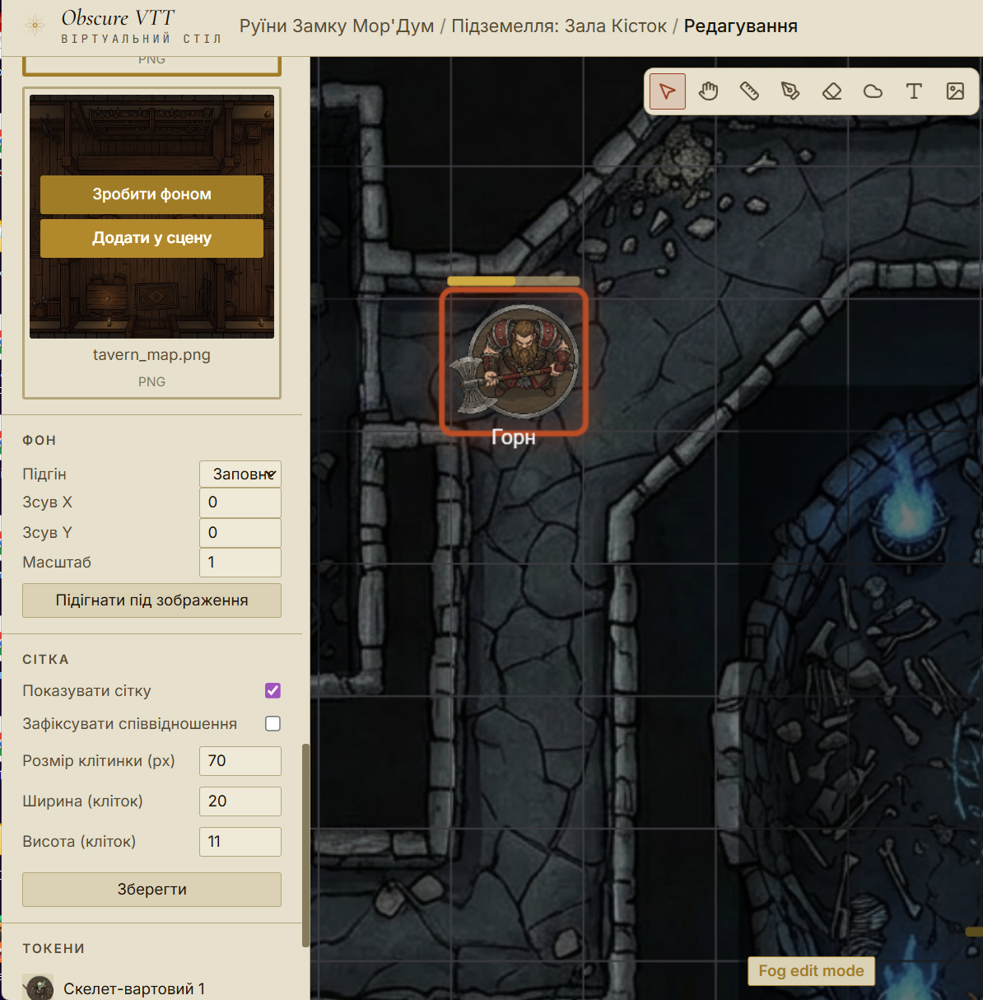
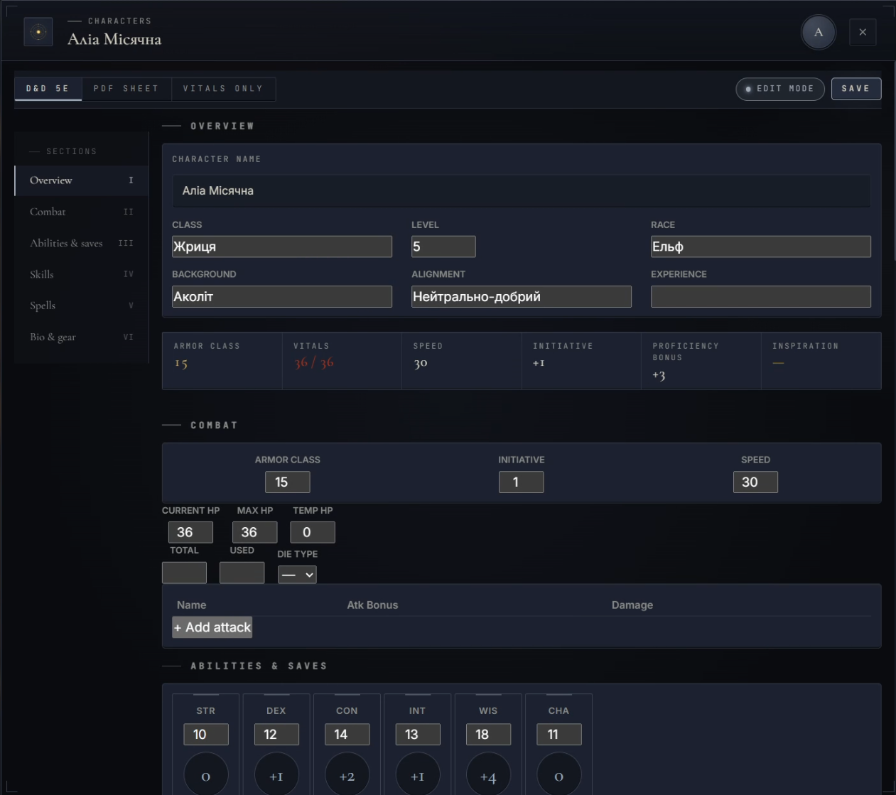
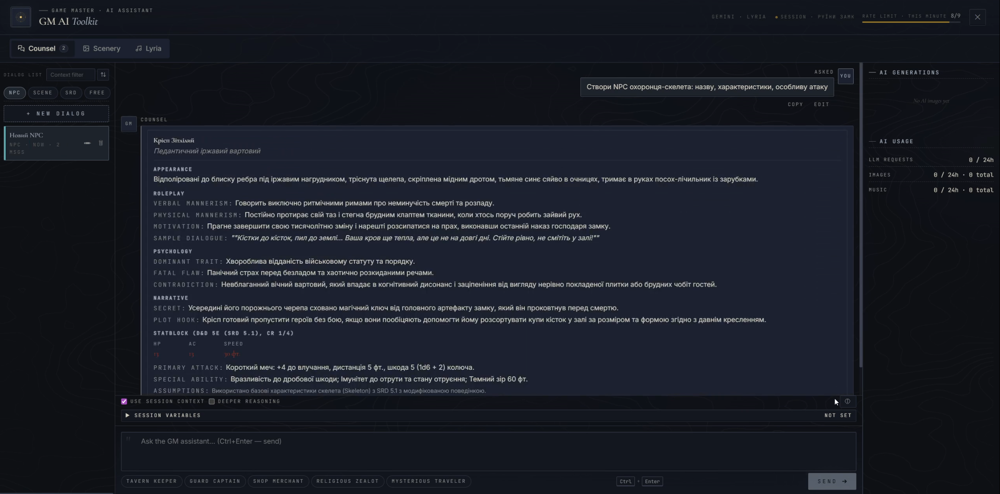
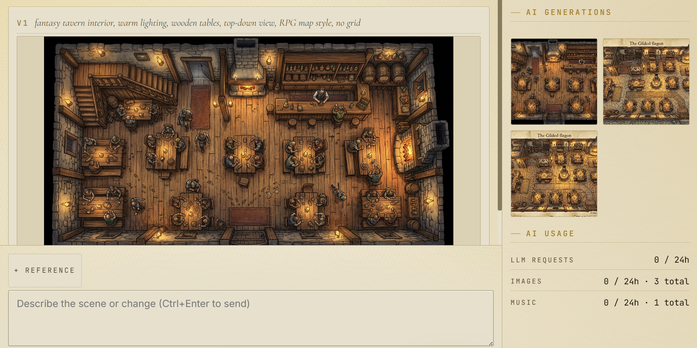

# Obscure VTT — Virtual Tabletop Platform

A full-stack web application for playing tabletop role-playing games online. Obscure VTT brings a shared game board, real-time communication, campaign tools, and AI content generation into one workspace for Game Masters and players.

Developed as an individual bachelor's project in Computer Science at Odesa Polytechnic National University (2026).



*The Game Master controls which parts of the map are revealed while preparing and running a session.*

> The hosted demo is currently unavailable because the paid cloud services have been discontinued. The screenshots below showcase the completed application.

[Features](#features) · [Engineering highlights](#engineering-highlights) · [Screenshots](#screenshots) · [Tech stack](#tech-stack) · [Development](#development)

## Features

- **Shared tabletop:** scenes, character tokens, grid snapping, drawing and annotations, and Fog of War.
- **Session management:** rooms, invitations, and distinct Game Master, Player, and Observer roles.
- **Communication:** in-character and out-of-character chat, private messages, and WebRTC audio/video calls.
- **Campaign tools:** character sheets, initiative tracking, journals, shared handouts, and background music.
- **Dice rolls:** dice formulas, shared results, private GM rolls, and 3D dice animation.
- **AI tools for the Game Master:** a contextual text assistant, image generation for scenes and tokens, and music generation through Google Vertex AI.
- **Interface options:** English and Ukrainian localization, with light and dark themes.

## Engineering highlights

| Area | Implementation | Explore the code |
| --- | --- | --- |
| Authentication and authorization | JWT access and refresh tokens, password hashing, and server-side role and room access checks. | [Authentication service](apps/server/src/services/AuthService.ts), [access policy](apps/server/src/auth/policy.ts) |
| Real-time state | Socket.IO events synchronize the tabletop. Version checks protect token movement against stale updates; reconnecting clients can request a state snapshot. | [Scene service](apps/server/src/services/SceneService.ts), [session resynchronization](apps/server/src/services/SessionResyncService.ts) |
| Data and persistence | PostgreSQL stores rooms, scenes, memberships, characters, and campaign content. Prisma provides the data model and migrations, with JSONB fields for flexible structures. | [Database schema](apps/server/prisma/schema.prisma), [repositories](apps/server/src/repositories) |
| External integrations | Separate AI and storage interfaces isolate provider-specific code. WebRTC uses application signaling and optional TURN relay infrastructure. | [AI providers](apps/server/src/infrastructure/ai), [storage adapters](apps/server/src/infrastructure/storage), [TURN configuration](apps/server/src/services/TurnConfigProvider.ts) |
| Shared contracts | A pnpm monorepo keeps client, server, and shared TypeScript types together. | [Shared package](packages/shared), [server tests](apps/server/tests) |

## Screenshots

Captured during the thesis demonstration period in May 2026. The examples include both interface themes and Ukrainian campaign content. Click an image to view it at full size.

### Scene editor

Choose map assets, configure the grid, and arrange tokens before activating a scene.



### Character sheet

Manage character details, health, abilities, and combat information in the built-in D&D 5e sheet.



### Game Master assistant

Create NPC descriptions and session material through a conversational interface with optional session context.



### Image generation

Generate scene artwork from a prompt and review results in the image workspace.



## Tech stack

| Layer | Technologies |
| --- | --- |
| Frontend | React, TypeScript, Vite, Redux Toolkit, React Router, i18next |
| Game board and dice | Konva / react-konva, dice-box-threejs |
| Backend | Node.js, Express, TypeScript, Zod |
| Real-time communication | Socket.IO, WebRTC, coturn |
| Database | PostgreSQL, Prisma ORM |
| Authentication | JWT, bcrypt |
| AI and media storage | Google Vertex AI (Gemini and Lyria), Google Cloud Storage |
| Testing and automation | Vitest, Testing Library, Supertest, Playwright, Artillery, GitHub Actions |

The thesis deployment used Vercel for the frontend, Railway for the application server, Supabase for PostgreSQL, and Google Cloud services for storage, AI, and the TURN host. These describe the deployment used for the project demonstration, not an active hosted service.

## Repository structure

```text
apps/client/       React application and tabletop interface
apps/server/       Express API, Socket.IO handlers, services, and Prisma
packages/shared/   Shared TypeScript types and contracts
infra/             Database, storage, TURN, and deployment guides
loadtest/          Load-testing scenarios and documentation
docs/screenshots/  Selected application screenshots
.github/workflows/ CI configuration
```

## Development

The repository configuration specifies Node.js 20 and pnpm 9. PostgreSQL is required for application data; cloud-backed features require their corresponding service configuration.

1. Install workspace dependencies with `pnpm install --frozen-lockfile`.
2. Create `apps/server/.env` using [`.env.example`](.env.example) as the configuration reference. Set `DATABASE_URL` and `JWT_SECRET`; configure the cloud and TURN variables for those integrations. The server's development command reads `.env` from `apps/server/`.
3. Provide a PostgreSQL database. The included [Docker Compose configuration](docker-compose.yml) has a local database service: `docker compose up -d postgres`.
4. Generate the Prisma client and apply migrations:

   ```bash
   pnpm --filter @vtt/server exec prisma generate
   pnpm --filter @vtt/server exec prisma migrate deploy
   ```

5. Start the client and server with `pnpm dev`. The default development ports are `5173` for the client and `4000` for the server.

Without Google Cloud configuration, the server includes a local file storage adapter and disables AI generation. WebRTC connections that require a relay need a configured TURN server.

### Checks included in the repository

```bash
pnpm type-check
pnpm lint
pnpm test
```

[GitHub Actions](.github/workflows/ci.yml) defines the type-check, lint, and test jobs. Browser scenarios are in [the E2E suite](apps/e2e/tests); load-testing setup is documented in [the load-test guide](loadtest/README.md).

### Infrastructure documentation

The existing infrastructure guides are primarily in Ukrainian and describe the thesis deployment setup:

- [PostgreSQL / Supabase](infra/supabase/README.md)
- [Google Cloud Storage](infra/gcs/README.md)
- [coturn / TURN](infra/coturn/README.md)
- [Deployment smoke checks](infra/smoke/README.md)
- Server deployment: [Dockerfile](apps/server/Dockerfile) and [Railway configuration](railway.json)
- Frontend deployment: [Vercel configuration](apps/client/vercel.json)

## License

[MIT](LICENSE) · Lev Semyvolos
